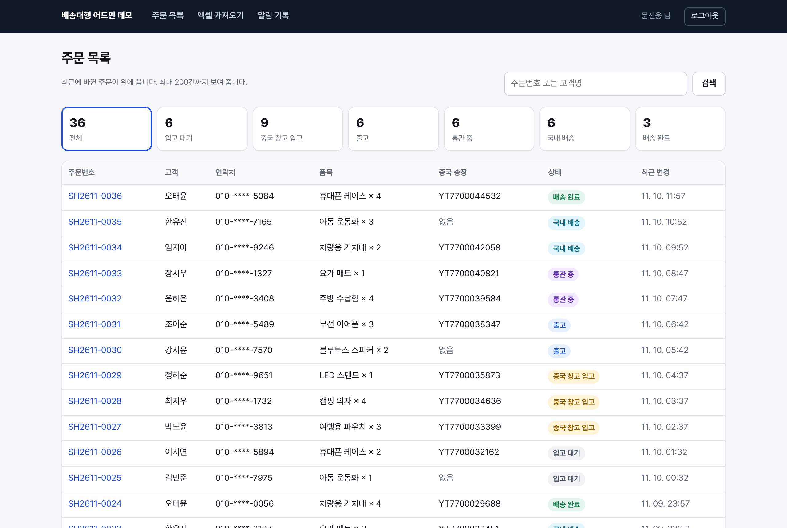
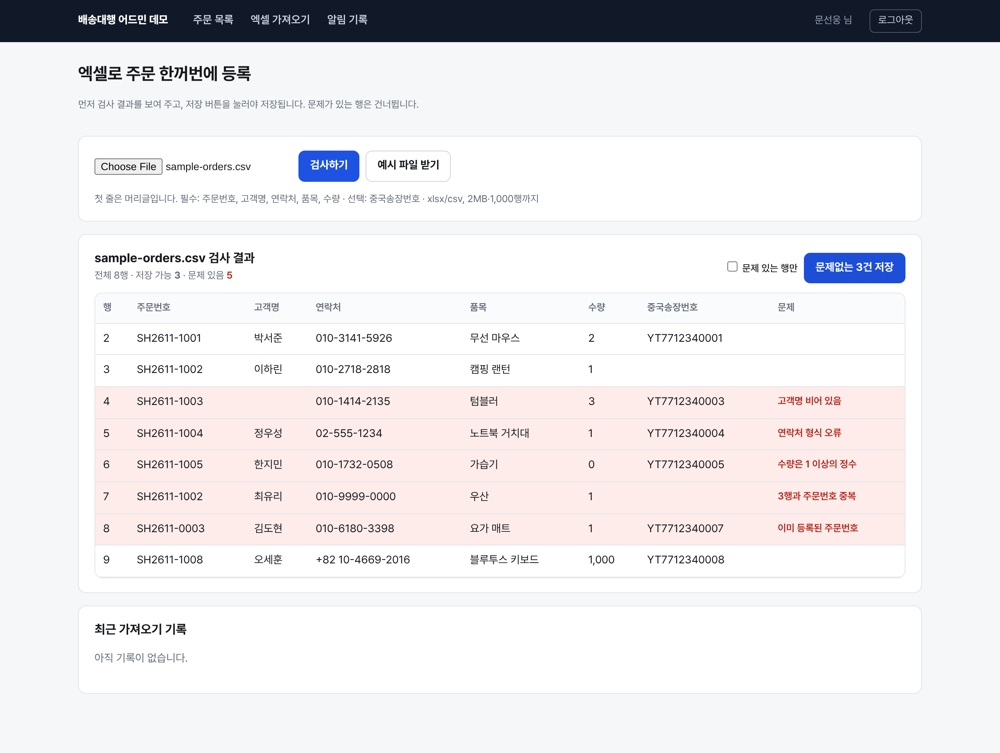

# 배송대행 어드민 데모

중국→한국 배송대행 주문을 직원이 관리하고, 고객이 직접 배송 단계를 확인하는 웹 관리 화면 연습 프로젝트입니다.
물류 회사의 웹 관리 화면·업무 자동화 직무를 준비하면서, 그 일을 작게 따라 만들어 본 것입니다.

> 실제 회사의 데이터·시스템과 관계없습니다. 주문 데이터는 모두 가상입니다.

**만든 방식** 공고를 바탕으로 만들 범위를 정하고 결과를 확인한 것은 문선웅, 코드와 테스트는 Claude Code가 작성했습니다. 자세한 내용은 아래 [역할](#역할)에 있습니다.



## 할 수 있는 것

| 화면 | 기능 |
|---|---|
| 주문 목록 `/admin` | 상태별 건수와 필터, 주문번호·고객명 검색. 연락처는 가운데를 가려서 표시 |
| 주문 상세 `/admin/shipments/:id` | 6단계 진행 표시, 다음 단계로 변경, 누가 언제 바꿨는지 이력, 고객 알림 기록 |
| 엑셀 가져오기 `/admin/import` | xlsx·csv를 올리면 먼저 검사 결과를 행 번호와 함께 보여 주고, 문제없는 행만 저장 |
| 알림 기록 `/admin/notifications` | 상태가 바뀔 때 만든 고객 알림 문구와 전송 결과 |
| 고객 조회 `/track` | 주문번호 + 전화번호 뒷자리 4자리로 내 배송 단계 확인 (휴대폰 화면 대응) |

배송 단계: 입고 대기 → 중국 창고 입고 → 출고 → 통관 중 → 국내 배송 → 배송 완료

## 정한 규칙과 이유

| 규칙 | 이유 |
|---|---|
| 상태는 한 단계씩 앞으로만 | 실수로 건너뛰거나 되돌리면 고객에게 잘못된 알림이 갑니다. |
| 화면에서 본 상태가 그사이 바뀌었으면 저장하지 않음 | 두 직원이 같은 주문을 동시에 누르면 한 명만 성공하고, 다른 한 명에게는 "다른 직원이 바꿨다"고 알려 줍니다. (`update … where status = 화면에서 본 상태`) |
| 엑셀은 검사 → 확인 → 저장 두 단계 | 한 번에 수십 건을 넣는 작업이라, 틀린 행이 조용히 들어가면 찾기 어렵습니다. 저장할 때는 서버가 파일을 다시 검사하고 브라우저가 보낸 결과를 믿지 않습니다. |
| 파일 안 중복과 이미 등록된 주문번호를 구분 | 직원이 고쳐야 할 곳이 다릅니다(파일 수정 vs 이미 처리된 주문). |
| 알림이 실패해도 상태 변경은 유지 | 알림은 상태가 저장된 뒤에 보내고, 실패는 기록으로 남겨 다시 확인할 수 있게 했습니다. |
| 고객 조회는 주문번호와 뒷자리가 모두 맞을 때만 | 틀렸을 때 "주문번호는 있는데 번호가 틀림"을 구분하지 않아 주문번호를 추측하기 어렵게 했습니다. 연락처·직원 이름은 보내지 않고 고객 이름은 가립니다. 같은 IP에서 10분에 10번까지만 조회됩니다. |
| Supabase 테이블에 RLS를 켜고 정책은 두지 않음 | Supabase는 anon 키로 REST API를 엽니다. 정책이 없으면 브라우저에서 테이블을 직접 읽을 수 없고, 서버(DB 연결 문자열)만 접근합니다. |



## 기술

Next.js 15(App Router, Server Actions) · TypeScript · PostgreSQL(Supabase) · ExcelJS · Vitest · Playwright

- `DATABASE_URL`이 있으면 Supabase Postgres에, 없으면 내장 PGlite(브라우저·Node용 Postgres)에 저장합니다. 두 경우 모두 같은 SQL(`db/schema.sql`)을 씁니다. 그래서 계정 없이도 `npm run dev`만으로 실행해 볼 수 있습니다.
- 직원 로그인은 데모용 비밀번호 하나와 이름으로 들어가고, HMAC으로 서명한 쿠키(8시간)를 씁니다. middleware와 서버 액션에서 각각 확인합니다.

## 실행

```bash
npm install
npm run dev          # http://localhost:3000 , 직원 비밀번호 demo1234
```

처음 실행하면 `.data/pglite`에 가상 주문 36건이 만들어집니다. 다시 시작하려면 `.data` 폴더를 지우면 됩니다.
엑셀 가져오기는 `public/sample-orders.csv`(일부러 문제 행 5개를 넣음)로 시험할 수 있습니다.

### Supabase + Vercel 배포

1. Supabase 새 프로젝트 → SQL Editor에 `db/schema.sql` 붙여 넣고 실행 (또는 `DATABASE_URL=... npm run db:setup`)
2. Project Settings → Database → Connection string에서 **Transaction pooler**(포트 6543) 주소 복사
3. Vercel에서 이 저장소를 가져오고 환경변수 설정: `DATABASE_URL`, `ADMIN_PASSWORD`, `SESSION_SECRET`(16자 이상), 데모 공개용이면 `DEMO_MODE=true`, `SEED_DEMO=true`
4. 상태 변경 알림을 실제로 받아 보려면 Slack 또는 Discord 웹훅 주소를 `NOTIFY_WEBHOOK_URL`에

변수 설명은 `.env.example`에 있습니다.

## 검증

| 종류 | 내용 | 결과 |
|---|---|---|
| 단위·DB 테스트 `npm test` | 상태 순서, 엑셀 행 검증 9가지, xlsx 읽기, 동시 변경 충돌, 가져오기 중복, 고객 조회 정보 노출, 알림 실패 시 상태 유지, 세션 위조·만료 | 26개 통과 (PGlite 사용) |
| 브라우저 흐름 `npm run test:e2e` | 로그인 거부·성공 → 필터 → 상태 변경 → 다른 탭 충돌 → 엑셀 검사·저장 → 알림 기록 → 고객 조회(틀린 번호, 정보 가림, 횟수 제한) → 쿠키 없이 접근 차단 | 13단계 통과 (`npm run build && DEMO_MODE=true PORT=3100 npm start` 후 실행) |
| 타입·린트·빌드 | `npm run typecheck`, `npm run lint`, `npm run build` | 통과. GitHub Actions에서 같은 순서로 실행 |

### 브라우저 검사에서 찾은 문제

- **틀린 비밀번호를 넣으면 이름 칸까지 지워짐**: React 19는 서버 액션이 끝나면 폼을 초기화합니다. 단위 테스트로는 보이지 않았고, 브라우저 흐름 검사에서 두 번째 로그인이 "이름을 입력하세요"로 실패하며 드러났습니다. 입력값을 결과와 함께 돌려받아 다시 채우도록 고쳤습니다.
- **고객 조회에서도 같은 문제**: 뒷자리를 잘못 넣으면 주문번호까지 지워져 처음부터 다시 입력해야 했습니다. 같은 방식으로 고쳤습니다.

## 하지 않은 것 (알고 있는 한계)

- Supabase 실제 연결은 이 저장소의 테스트에 포함되어 있지 않습니다. 테스트는 같은 SQL을 PGlite에서 돌린 결과입니다.
- 조회 횟수 제한은 서버 메모리에 있어 서버가 여러 대이거나 재시작되면 초기화됩니다. 실제 서비스라면 DB나 Redis에 둬야 합니다.
- 직원 권한 등급, 비밀번호별 계정, 실제 문자·카카오톡 발송, 운임 계산, 중국어 화면은 없습니다.
- 목록은 최대 200건까지만 보여 주고 페이지 나누기는 없습니다.

## 역할

| 누가 | 한 일 |
|---|---|
| 문선웅 | 공고에 맞춘 프로젝트를 만들기로 결정, Claude Code가 제안한 범위·규칙 검토와 확정, 결과 화면 확인 |
| Claude Code | 범위·규칙 초안 제안, 코드 작성, 테스트·브라우저 검사 작성과 실행, 검사에서 나온 버그 수정, 이 README 초안 |
